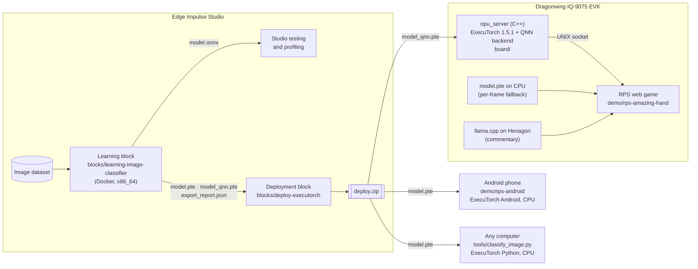

# PyTorch to ExecuTorch with Edge Impulse

Use a custom learning block in [**Edge Impulse Studio**](https://www.edgeimpulse.com/product) to train a PyTorch model, then export a portable ExecuTorch program and, with one extra flag, an NPU build for the IQ-9075.

| Artifact | Runs on | How it is made |
|---|---|---|
| `model.pte` | **Any Arm or x86 CPU** with the ExecuTorch runtime: Linux boards and laptops, Android phones, and more. The same file runs on a Qualcomm IQ-9075 board, an x86 Linux machine, and a Samsung Galaxy S26. | `torch.export`, then the XNNPACK partitioner |
| `model_qnn.pte` | **The Hexagon NPU** on a Qualcomm Dragonwing IQ-9075, when you want hardware acceleration | PT2E int8 quantization with `QnnQuantizer`, then lowering through the QNN backend for `QCS9100` (Hexagon v73) |

The examples use a rock-paper-scissors model: a web game on Linux, with the option to run it on the IQ-9075 NPU and add an Amazing Hand and LLM commentary, and an Android app that runs the same `model.pte` on a phone.

What this shows:
1. A PyTorch developer can get a **portable ExecuTorch program** from Edge Impulse Studio. The same file runs unchanged on a Linux board and on an Android phone.
2. With **one extra flag**, the same training run also produces a program for the **Qualcomm NPU**, and accuracy stays the same after int8 quantization (0.9744, equal to float32).
3. On the IQ-9075, vision inference runs on the NPU instead of the CPU, while an LLM uses the same NPU.

**No IQ-9075?** The CPU path works without one, and the pre-trained models are on the [Releases](../../releases) page. **A different NPU?** [docs/retargeting.md](docs/retargeting.md) shows what changes for other chips and NPUs.

> **Context.** The Edge Impulse blog post [From PyTorch to the Edge](https://www.edgeimpulse.com/blog/from-pytorch-to-the-edge-getting-started-with-executorch-and-edge-impulse/) (September 2026) introduced the ExecuTorch blocks on the CPU path and listed NPU acceleration as future work. This repository is the next step: the same learning block, with one extra flag, also produces an NPU program. The model runs on the IQ-9075 NPU with no accuracy loss compared with float32.

## Contents

- [Quick start](#quick-start)
  - [Any computer or phone](#any-computer-or-phone)
  - [Qualcomm IQ-9075: the NPU](#qualcomm-iq-9075-the-npu)
- [Prerequisites](#prerequisites)
- [Pick your path](#pick-your-path)
  - [A. No hardware](#a-no-hardware-run-and-understand-the-cpu-side)
  - [B. Edge Impulse Studio](#b-edge-impulse-studio-train-and-get-both-pte-files)
  - [C. IQ-9075 EVK](#c-iq-9075-evk-run-the-model-on-the-npu)
  - [D. The demos](#d-the-demos-web-game-and-android-app)
  - [E. Another block](#e-another-block-timeseries-keyword-spotting-or-fomo)
- [Repository map](#repository-map)
- [How it fits together](#how-it-fits-together)
- [Results](#results)
- [Versions that must agree](#versions-that-must-agree)
- [License and credits](#license-and-credits)

---

## Quick start

### Any computer or phone

**1. Run the pre-trained model on a photo** (about 5 minutes; Python 3.10–3.13).

```bash
git clone <repo-url> && cd edge-impulse-executorch-qnn
curl -LO <repo-url>/releases/latest/download/model.pte
curl -LO <repo-url>/releases/latest/download/labels.txt

python -m venv .venv && . .venv/bin/activate
pip install executorch==1.5.1 torch==2.14.0 opencv-python numpy
# (on Linux, add --extra-index-url https://download.pytorch.org/whl/cpu to skip the CUDA packages)

python tools/classify_image.py model.pte labels.txt my_hand.jpg
```

Take a photo of your hand making rock, paper or scissors. The script prints the class scores and the time for one inference on your CPU.

**2. Run the same file on an Android phone.** Copy `model.pte` and `labels.txt` into `demo/rps-android/app/src/main/assets/`, open `demo/rps-android` in Android Studio, and press Run with your phone plugged in. The app plays rock-paper-scissors with the phone's camera and shows the model's hash, so you can see it is the same file. Details: [demo/rps-android/README.md](demo/rps-android/README.md).

**3. Play the web game on a Linux laptop with a webcam.**

```bash
cd demo/rps-amazing-hand && ./install.sh && ./start.sh      # pick the camera, open http://localhost:8000
```

It uses the CPU model that ships in `demo/rps-amazing-hand/models/`. Details: [demo/rps-amazing-hand/README.md](demo/rps-amazing-hand/README.md).

**4. Train your own model.** Push the learning block to Edge Impulse and train an image project ([path B](#b-edge-impulse-studio-train-and-get-both-pte-files)). To try the block first with no account, run it on fake data. This needs Docker on an x86_64 machine, and the first build takes about 20 minutes, mostly downloading the Qualcomm SDK:

```bash
docker build -t ei-executorch-qnn blocks/learning-image-classifier
python tools/make_fake_data.py /tmp/ei-data --size 96 --classes 4
mkdir -p /tmp/ei-out
docker run --rm -v /tmp/ei-data:/data -v /tmp/ei-out:/out ei-executorch-qnn \
    --data-directory /data --out-directory /out --epochs 2 --export-pte --export-qnn
ls /tmp/ei-out                  # model.onnx  model.pte  model_qnn.pte  export_report.json
```

`"status": "ok"` and `"qnn_delegate_present": true` in `export_report.json` mean the model was also compiled for the NPU. The accuracy is meaningless on random data; this only proves the pipeline works.

### Qualcomm IQ-9075: the NPU

You need an IQ-9075 EVK on Ubuntu 24.04 with SSH and `sudo`.

**1. Get the NPU model onto the board.** Use `model_qnn.pte` and `export_report.json` from the [Releases](../../releases) page, or from your own training run.

```bash
ssh <user>@<board-ip> mkdir -p npu-model
scp model_qnn.pte export_report.json <user>@<board-ip>:npu-model/
```

**2. Install the runtime and check the model on the NPU** (on the board):

```bash
git clone <repo-url> && cd edge-impulse-executorch-qnn/board
./setup.sh  ~/npu-model/model_qnn.pte ~/npu-model/export_report.json   # 30-60 min the first time
./verify.sh ~/npu-model                                                # expect: PASS  runs on the NPU
```

`setup.sh` installs everything it needs, builds the ExecuTorch runtime with the QNN backend, and starts the `rps-npu` service. If someone has shared a prebuilt runtime, `./install-prebuilt.sh <package> ~/npu-model/model_qnn.pte` replaces `setup.sh` and takes about a minute ([board/README.md](board/README.md)).

**3. Play the game on the NPU:**

```bash
cd ../demo/rps-amazing-hand && ./install.sh && ./start.sh             # open http://<board-ip>:8000
```

The log shows `detector: NPU ACTIVE`. If the NPU service stops, the game carries on with the CPU model, frame by frame. The Amazing Hand and LLM commentary are optional ([demo README](demo/rps-amazing-hand/README.md)).

---

## Prerequisites

You don't need everything below. Pick a path in the next section, then check its row in the table.

### What it helps to know

- **Edge Impulse Studio basics:** creating a project, uploading and labeling images, building an impulse (input → processing block → learning block), training, and the **Deployment** page. The [custom learning block docs](https://docs.edgeimpulse.com/studio/organizations/custom-blocks/custom-learning-blocks) cover these.
- **What a custom block is:** a Docker image that Studio runs for you, with its settings in `parameters.json`. See [custom learning blocks](https://docs.edgeimpulse.com/studio/organizations/custom-blocks/custom-learning-blocks) and [custom deployment blocks](https://docs.edgeimpulse.com/studio/organizations/custom-blocks/custom-deployment-blocks).
- **A Linux terminal.** For the board, also SSH and `sudo`.
- **PyTorch** helps when reading the block code.
- The [**Edge Impulse ExecuTorch blog post**](https://www.edgeimpulse.com/blog/from-pytorch-to-the-edge-getting-started-with-executorch-and-edge-impulse/) gives context on where this work started.

### What you need for each path

| Path | You need |
|---|---|
| **A. No hardware** | <ul><li>Linux or macOS (on Windows, use WSL2), with `git` and Python 3.10–3.13.</li><li>About 3 GB of disk for the Python environment (torch and ExecuTorch).</li><li>For the Docker build only: Docker on an x86_64 machine, internet access, and about 10 GB free for the image. Apple Silicon works under emulation, but slowly.</li></ul> |
| **B. Edge Impulse Studio** | <ul><li>An [Edge Impulse account](https://studio.edgeimpulse.com/signup). A free developer profile can push and use the learning block.</li><li>The Edge Impulse CLI: `npm install -g edge-impulse-cli`, which needs Node.js 16 or later (22 recommended).</li><li>An image classification project with labeled images. The example used four classes: Rock, Paper, Scissors and unknown.</li><li>Docker, to run the block locally with `edge-impulse-blocks runner`.</li><li>For `deploy.zip` from Studio: an **Enterprise** organization that owns the project. Without one, run the learning block locally instead.</li><li>More information can be found in the [Edge Impulse Studio docs](https://docs.edgeimpulse.com/studio/)</li></ul> |
| **C. IQ-9075 EVK** | <ul><li>A Qualcomm Dragonwing IQ-9075 EVK with Ubuntu 24.04, on the network and reachable over SSH, with a user that has `sudo`.</li><li>Internet access on the board, and about 10 GB free in `$HOME` for the build. Neither is needed with `install-prebuilt.sh`.</li><li>`model_qnn.pte` and `export_report.json`, from the Releases page or path B, plus the test split (`X_split_test.npy`, `Y_split_test.npy`) for the full accuracy check.</li><li>No Qualcomm account and no SDK download: the board uses Ubuntu's Qualcomm packages, and the scripts install them.</li></ul> |
| **D. The demos** | <ul><li>**Android app:** Android Studio (Ladybug or newer) and an Android phone (arm64, Android 8.0 or newer) with USB debugging on.</li><li>**Web game:** a Linux machine with a USB webcam (a V4L2 device such as `/dev/video0`) and Python 3.10 or later. A CPU model is included.</li><li>Optional, for the NPU: the EVK with the `rps-npu` service from path C.</li><li>Optional, for the hand: an [Amazing Hand](https://github.com/pollen-robotics/AmazingHand) on a USB serial port, with your user in the `dialout` group.</li><li>Optional, for LLM commentary: an x86_64 machine with Docker to cross-compile llama.cpp for Hexagon, and about 0.8 GB for the GGUF model. The Llama model may need you to accept its license on Hugging Face.</li></ul> |
| **E. Another block** | <ul><li>`git` and Python 3.</li><li>Then the same as paths A and B to train it, and path C to run it on the board.</li></ul> |

---

## Pick your path

### A. No hardware: run and understand the CPU side

```bash
# 1. Classify a photo with the pre-trained model.pte (see the Quick start for the download)
python tools/classify_image.py model.pte labels.txt my_hand.jpg

# 2. Look inside a .pte to see which backend it was lowered to
python tools/inspect_pte.py model.pte

# 3. Run the learning block's tests (trains a tiny model, exports a .pte and checks it is fully XNNPACK-delegated)
cd blocks/learning-image-classifier
python -m venv .venv && . .venv/bin/activate
pip install -r requirements.txt pytest
python -m pytest -q
```

With the block's pinned torch 2.12.1 the tests give 7 passed and 1 skipped. The skipped check loads the exported `.pte` back into the ExecuTorch 1.5.1 runtime, which needs torch 2.14 ([why](docs/versions.md)). To run it too: `pip install torch==2.14.0 "torchvision==0.29.*"`.

```bash
# 4. (x86_64 with Docker) Build the block image. The build itself runs a QNN
#    lowering smoke test, so a successful build proves the NPU compile path works on your machine.
docker build -t ei-executorch-qnn blocks/learning-image-classifier
```

Step 4 downloads about 1.9 GB of Qualcomm SDK and libc++ while it builds. To run the whole block, including the QNN export, against fake data with no Edge Impulse account, see the [Quick start](#any-computer-or-phone) or [blocks/learning-image-classifier/README.md](blocks/learning-image-classifier/README.md#run-it-locally).

### B. Edge Impulse Studio: train and get both `.pte` files

Push the learning block and train an image project with **Export QNN .pte** checked. Then either:
- push the deployment block and download `deploy.zip` (needs an Enterprise org), or
- run the learning block locally with `edge-impulse-blocks runner`, which writes `model.pte` and `model_qnn.pte` straight to your disk (works on a free developer account).

Steps: [docs/reproduce-on-iq9.md § 1–2](docs/reproduce-on-iq9.md).

### C. IQ-9075 EVK: run the model on the NPU

```bash
cd board
./setup.sh  ~/npu-model/model_qnn.pte ~/npu-model/export_report.json   # installs prerequisites, builds (30–60 min, once), installs the rps-npu service
./verify.sh ~/npu-model                                                # runs on the NPU? accuracy matches the export report?
```

If someone has shared a prebuilt runtime from `board/package.sh`, use `./install-prebuilt.sh <package> model_qnn.pte` instead of `setup.sh` and skip the build. Details: [board/README.md](board/README.md).

### D. The demos: web game and Android app

**Android app** ([demo/rps-android](demo/rps-android/README.md)): put `model.pte` and `labels.txt` in `app/src/main/assets/`, open the folder in Android Studio and run it on a phone. It includes a parity check that compares the phone's scores with Python's for the same photo.

**Web game** ([demo/rps-amazing-hand](demo/rps-amazing-hand/README.md)):

```bash
cd demo/rps-amazing-hand && ./install.sh && ./start.sh
```

It runs on any Linux machine with a webcam, using the CPU. On the EVK with `rps-npu` running, it uses the NPU.

Four optional pieces layer on top, each independent and each skipped with a message naming what is missing: the NPU, the Amazing Hand, LLM commentary, and spoken commentary. For the last two:

```bash
./scripts/fetch-llm-model.sh                   # commentary model (Q4_0 GGUF)
./scripts/fetch-tts-voice.sh                   # speech voice (Piper)

./scripts/check-llama-hexagon.sh models/Llama-3.2-1B-Instruct-Q4_0.gguf   # is the LLM on the NPU?
./scripts/check-audio.sh                                                  # can this board speak?
.venv/bin/python scripts/test-hand.py                                     # does the hand move?
```

Speech is local and CPU-side by design — the NPU is already carrying vision and the LLM. The reasoning and the audio-player resolution are in [docs/speech-and-actuation.md](docs/speech-and-actuation.md).

The sidebar's **Artifacts** panel makes the two-artifact claim visible while the game runs: which `.pte` is answering, its SHA-256 and input resolution, the delegate inside it, and what fell back to the CPU. Stop `rps-npu` mid-match and the badge flips to `CPU fallback` while the game carries on ([details](demo/rps-amazing-hand/README.md#artifact-panel)).

### E. Another block: timeseries, keyword spotting or FOMO

```bash
# from the folder that holds both this repository and the block
git clone https://github.com/edgeimpulse/executorch-pytorch-kws-block
python edge-impulse-executorch-qnn/porting/apply_port.py executorch-pytorch-kws-block   # any of the three
```

Same flag, same report, same board runtime. See [docs/porting-to-other-blocks.md](docs/porting-to-other-blocks.md) for what changes and why, how to test with fake data, and what each block still needs on the device.

**Another chip?** [docs/retargeting.md](docs/retargeting.md) maps what changes for other chips, NPUs and microcontrollers.

---

## Repository map

| Path | What it is | Needs hardware? |
|---|---|---|
| [`blocks/learning-image-classifier/`](blocks/learning-image-classifier/) | **Custom learning block**: PyTorch training, then ONNX, CPU `.pte` and QNN `.pte` | No, it runs anywhere Docker runs (x86_64) |
| [`blocks/deploy-executorch/`](blocks/deploy-executorch/) | **Custom deployment block**: CPU int8 `.pte` plus QNN pass-through into `deploy.zip` | No (pushing it to Studio needs an Enterprise org) |
| [`demo/rps-android/`](demo/rps-android/) | Android app: rock-paper-scissors with the phone's camera, running `model.pte` on the phone's CPU | An Android phone (arm64, Android 8.0+) |
| [`demo/rps-amazing-hand/`](demo/rps-amazing-hand/) | Rock-paper-scissors web app: NPU-first inference with CPU fallback, optional Amazing Hand, LLM commentary and local text to speech ([how those work](docs/speech-and-actuation.md)) | Any Linux machine with a webcam; the NPU path needs the EVK |
| [`board/`](board/) | `setup.sh` builds ExecuTorch + QNN on the board and installs the model as the `rps-npu` service; `verify.sh` proves it runs on the NPU; `package.sh` / `install-prebuilt.sh` let other boards skip the build. Also the `npu_server` C++ source. | IQ-9075 EVK |
| [`porting/`](porting/) | `apply_port.py` + kit + patches that add the same NPU export to Edge Impulse's public **timeseries, KWS and FOMO** ExecuTorch blocks ([guide](docs/porting-to-other-blocks.md)) | No |
| [`tools/`](tools/) | Classify a photo with any image `model.pte`, inspect a `.pte` (which backends are inside it), evaluate one on Studio's test split, and generate fake data for a local block run | No |
| [`docs/`](docs/) | How it works, design decisions, step-by-step reproduction, porting to other blocks, retargeting to other chips, speech and actuation, the dataset, results, versions, troubleshooting, roadmap | No |

---

## How it fits together



1. **Learning block.** Studio passes in the image data. The block fine-tunes MobileNetV2 in PyTorch and writes:
   - `model.onnx`, which Studio uses for testing and profiling
   - `model.pte`, the portable CPU program
   - with **Export QNN .pte** checked: `model_qnn.pte` plus `export_report.json`, which records accuracy before and after quantization, how much of the graph runs on the NPU, the SoC and the SDK version
2. **Deployment block.** Studio only exposes learning-block outputs through a deployment, so this block packages them into `deploy.zip`:
   - it builds a CPU int8 `model.pte` from Studio's ONNX export
   - it copies `model_qnn.pte` and `export_report.json` through unchanged
3. **Anywhere with a CPU.** `model.pte` runs with the standard ExecuTorch runtime: the pip package on Linux, or the Android library in the phone app. Nothing is rebuilt per device.
4. **The IQ-9075 NPU.** The aarch64 pip wheel of ExecuTorch has no QNN backend, so the board builds ExecuTorch 1.5.1 with QNN from source. A small C++ server keeps the NPU model loaded and serves inferences over a UNIX socket.
5. **The demos.** The web game sends each camera frame to the NPU server, and falls back to the CPU `model.pte` for any frame the server can't answer. The Android app runs `model.pte` directly on the phone.

[docs/how-it-works.md](docs/how-it-works.md) walks through each step in detail. The reasoning behind the main choices, with the alternatives considered, is in [docs/design-decisions.md](docs/design-decisions.md).

---

## Results

All numbers come from **one training run**: MobileNetV2 fine-tuned on a 4-class rock/paper/scissors/unknown dataset at 96×96, scored on the same 78 test images. These are the models on the [Releases](../../releases) page.

| | float32 (reference) | `model.pte` (CPU, int8, XNNPACK) | **`model_qnn.pte` (IQ-9075 NPU, int8 8a8w)** |
|---|---|---|---|
| Accuracy (78 held-out images) | 0.9744 | 0.9487 | **0.9744** |
| File size | 8.9 MB | 2.4 MB | 2.6 MB |

**Where `model.pte` has run, and how fast** (one inference):

| Device | Runtime | Latency |
|---|---|---|
| Qualcomm IQ-9075, Kryo CPU | ExecuTorch Python | ~0.4–1.4 ms¹ |
| x86_64 Linux | ExecuTorch 1.5.1 Python | ~1 ms |
| Samsung Galaxy S26, CPU | ExecuTorch Android | *to be measured* |

**`model_qnn.pte` on the IQ-9075 NPU:** 0.23 ms per inference on the NPU, 0.70 ms round trip from Python.

¹ From an earlier 96×96 export on the board's Kryo cores. The CPU model shipped in `demo/rps-amazing-hand/models/` is a different, older 160×160 export.

The full numbers, and where each one came from, are in [docs/results.md](docs/results.md).

---

## Versions that must agree

| Piece | Version |
|---|---|
| ExecuTorch in the learning block **and** in the board's native build | **1.5.1** (`model_qnn.pte` must be run by the release that made it) |
| ExecuTorch for the CPU `model.pte` | Built with **1.3.1** by the deployment block. Runs on 1.3.1 (Android app, web game) and on 1.5.1 (Python, checked). |
| QNN SDK the NPU model is compiled with | 2.37.0.250724 (pinned by ExecuTorch 1.5.1) |
| QNN runtime on the board | apt `libqnn1` 2.46.0. An older compile on a newer runtime works; the reverse does not. |
| Compile target | `QcomChipset.QCS9100` (Hexagon v73). The IQ-9075 is not listed by name. |

Rules and the full matrix are in [docs/versions.md](docs/versions.md).

## License and credits

This project is licensed under **The Clear BSD License** — see
[LICENSE](LICENSE). Every source file owned by this project carries a
copyright line and the SPDX identifier `BSD-3-Clause-Clear` in its header.

It does **not** cover bundled third-party files, which keep their own terms:
the web fonts under `demo/rps-amazing-hand/app/static/fonts/` are SIL OFL 1.1,
with their license text alongside them.

### What is shipped and what is fetched

This matters if you redistribute this project or build on it.

**Shipped in this repository:** this project's own source, the trained
`model.pte`, the documentation screenshots, the synthetic Android test
fixtures, the porting patches, and the two web-font families with their OFL
license text.

**Not shipped — fetched from their own distributors at install time:**
ExecuTorch and PyTorch, llama.cpp, the Llama 3.2 weights, Piper and its voice,
the Qualcomm QNN SDK, and the rest of the pip dependencies. Their
redistribution terms are not triggered by this repository; they are triggered
by anyone who bundles them with it.

[NOTICE](NOTICE) is the authoritative record of that split, of every shipped
artifact's origin, and of the attribution obligations attached to each.
[THIRD-PARTY-NOTICES.md](THIRD-PARTY-NOTICES.md) covers the same ground with
the reasoning behind each choice, and
[docs/binary-provenance.md](docs/binary-provenance.md) maps every shipped
binary and document file.

### Credits

- The ExecuTorch blocks build on Edge Impulse's public `executorch-pytorch-*-block` and `executorch-deploy` repositories.
- The [Amazing Hand](https://github.com/pollen-robotics/AmazingHand) is by Pollen Robotics: Apache-2.0 for the software, CC BY 4.0 for the mechanical design.

**Built with Llama.** The optional spoken commentary uses Meta's
Llama 3.2 1B Instruct, under the
[Llama 3.2 Community License](https://www.llama.com/llama3_2/license/). The
model is downloaded at install time and is not redistributed here.

The gesture dataset's provenance, and the rules for collecting more images,
are in [docs/dataset.md](docs/dataset.md).