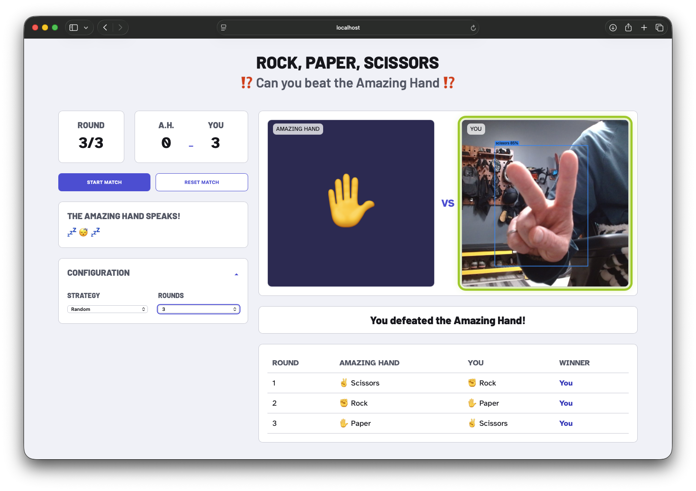

# Rock Paper Scissors: The Amazing Hand (ExecuTorch + Hexagon NPU)

This is the demo that sits on top of this repository's custom blocks. It is a camera-driven rock-paper-scissors game built with FastAPI and OpenCV: show a hand gesture to the camera during the capture window and play against The Amazing Hand.

Gesture recognition uses the **ExecuTorch models produced by the [learning block](../../blocks/learning-image-classifier/)**:
- `model_qnn.pte` on the **Hexagon NPU**, served by the [`rps-npu` service](../../board/)
- `models/model.pte` on the **CPU** as a per-frame fallback

Round commentary comes from Llama 3.2 1B running on the same NPU through llama.cpp's Hexagon backend.

> Two detectors ship side by side. The ExecuTorch one (`PteGestureDetector`, in `app/pte_perception.py`) is the one wired in. An Edge Impulse `.eim` detector (`EIGestureDetector`, in `app/perception.py`) is kept for an A/B comparison on the same hardware.

The browser displays the live camera feed, detected gesture boxes, a captured result frame, the round history, live match status, and commentary.



## Requirements

- A Linux host with a USB camera exposed as a V4L2 device such as `/dev/video0`. This can be the IQ‑9075 EVK or any Linux laptop.
- Python 3.10 or later
- `models/model.pte` (included, a CPU XNNPACK classifier at 160×160) and `models/labels.txt` (one label per line, in output order)
- Camera permissions for the user running the app
- **Optional:**
  - The NPU: the `rps-npu` service from [`board/`](../../board/README.md) (IQ‑9075 only)
  - The Amazing Hand on a serial port
  - A Hexagon llama.cpp build plus a GGUF model, for commentary
  - A Piper voice and any PCM audio player, for spoken commentary

With none of the optional pieces, the game still runs. Detection uses the CPU, and the hand, commentary and speech are each skipped with a message saying which piece is missing and how to add it.

## How detection works

```text
camera frame ─► centre-crop square ─► resize ─► RGB ─► /255 ─► NCHW float32
      │
      ├─► NPU: npu_client.py ── UNIX socket ──► rps-npu (npu_server + model_qnn.pte on HTP)
      │         returns logits ─► softmax
      └─► CPU fallback (that frame only): ExecuTorch Python runtime + models/model.pte (softmax built in)
      │
      ▼
smooth the last N probability vectors ─► gates (confidence, margin, max "unknown") ─► gesture or nothing
```

- **`HybridClassifier`** (`app/npu_inference.py`) tries the NPU for every frame. If a call fails, it answers that frame on the CPU and retries the NPU every 5 s. It logs `NPU ACTIVE` or `CPU FALLBACK` whenever the backend changes.
- **Each backend gets its own input size.** The NPU and CPU models can be different exports. Here the NPU model is 96×96 and the CPU one is 160×160. Only the class count has to match `labels.txt`.
- **No gesture is a valid answer.** The classifier has no "is there a hand?" output, so an empty frame still gets a class. The gates decide when a frame counts. A rejected frame produces no detection, and the round resolves as "no gesture captured". Tune the gates live with `RPS_LOG_PROBS=1` (see [Configuration](#configuration-and-defaults)).
- **No board?** `.venv/bin/python ../../tools/mock_npu_server.py --model models/model.pte --socket /tmp/rps-npu.sock` and `RPS_NPU_SOCKET=/tmp/rps-npu.sock ./start.sh` run the same code path on a laptop. The "NPU" is a CPU stand-in.

## Setup

### Sync files to the EVK

> **Two ways to get the app onto the board.** For the full reproduction, clone the **whole repository** on the EVK and run from `demo/rps-amazing-hand/`. `board/` and `tools/` are then next to it ([docs/reproduce-on-iq9.md](../../docs/reproduce-on-iq9.md)). `sync.sh` below is a development workflow that copies **only this folder** from your laptop.

Keep the laptop repository as the source of truth and sync it to the EVK with `sync.sh`. Run the script from the laptop repository root and pass the EVK SSH target:

```bash
./sync.sh user@evk-host
```

For example:

```bash
./sync.sh ubuntu@192.168.0.221
```

The default installation directory is `~/dev/demo-rock-paper-scissors-amazing-hand` for the remote SSH user. Provide an optional second argument to choose a different remote installation directory; relative paths are resolved from that user's home directory and absolute paths are used as-is:

```bash
./sync.sh user@evk-host dev/rps-demo
./sync.sh user@evk-host /opt/rps-demo
```

The script creates the destination directory, previews changes, and asks for confirmation before removing files on the EVK that are absent from the laptop. It skips `.git` and files matched by `.gitignore`, including `.venv`.

### Install requirements on the EVK

Connect to the EVK, change to the synced project directory, and install the Python requirements:

```bash
cd ~/dev/demo-rock-paper-scissors-amazing-hand
./install.sh
```

The installer:
- creates `.venv` (if one exists it refuses, so it never patches a broken install in place; `FORCE_REBUILD=1` rebuilds it)
- installs CPU-only `torch` first, so pip on aarch64 does not pull CUDA packages
- installs `requirements.txt`, which pins `executorch==1.3.1` to match the release that exported `models/model.pte`
- installs `requirements-speech.txt` (the TTS engine) separately and non-fatally, so a failure there cannot sink an otherwise working install; `SKIP_SPEECH=1` leaves it out

It then checks that the result imports, and refuses to finish if CUDA packages appear. It also reports whether the speech engine, a voice and an audio player are present, each with the command that adds the missing one. Run it after the first sync, and with `FORCE_REBUILD=1 ./install.sh` whenever `requirements.txt` changes.

The Python environment only runs the **CPU** model. The NPU model is served by the separate `rps-npu` service, which runs its own natively built ExecuTorch, so this environment never loads QNN.

## Run on the EVK

Connect the USB camera and start the application from the project root on the EVK:

```bash
./start.sh
```

`start.sh` detects the connected `/dev/video*` devices, filters out metadata-only nodes (some webcams, like the Logitech C920, expose a second non-capture device), and prompts you to pick a camera with the up/down arrow keys and Enter.

To skip the prompt, pass a device path directly to the launch command:

```bash
./start.sh /dev/video2
```

`start.sh` checks that `.venv` exists and its installed packages have no broken dependencies. If either check fails, it tells you to run `./install.sh`.

The startup script verifies that the selected path is a readable camera device before it starts the server. If it fails, check the available video devices and select the appropriate one:

```bash
ls -l /dev/video*
./start.sh /dev/videoN
```

### View on the EVK monitor

With a monitor, keyboard, and browser connected directly to the EVK, open this address in the EVK's browser:

```text
http://127.0.0.1:8000
```

`127.0.0.1` means the EVK itself, so this address works only in a browser running on the EVK.

### View from another device on the same network

The launcher starts Uvicorn on `0.0.0.0:8000`, which listens on the EVK's network interfaces. Find the EVK's LAN address:

```bash
hostname -I
```

On another phone, tablet, or computer connected to the same network, open:

```text
http://EVK-LAN-IP:8000
```

For example, if `hostname -I` shows `192.168.1.42`, use `http://192.168.1.42:8000`.

No VS Code port forwarding is needed for direct EVK or same-network access. If another device cannot connect, allow inbound TCP port `8000` in the EVK firewall and make sure the network does not isolate connected clients. Do not expose this unauthenticated camera application to the public internet.

## Play a match

1. Open **Configuration** and choose the computer strategy and number of rounds.
2. Select **Start Match**.
3. Hold Rock, Paper, or Scissors steady in the camera during the capture window after the countdown.
4. Review the round result, commentary, score, and match history.

The winning hand flashes green for each completed round. The final match result appears below the game board; the square flash still represents the most recent round, not the overall match winner.

## Architecture

```text
Browser (HTML/CSS/JavaScript)
        |
        | HTTP + WebSocket
        v
FastAPI application (app/main.py)
        |
        +-- GameEngine (app/game.py)
        |     +-- GestureDetector  -> PteGestureDetector (app/pte_perception.py)
        |     |                         +-- HybridClassifier (app/npu_inference.py)
        |     |                               +-- NpuClient (app/npu_client.py) -> rps-npu service (NPU)
        |     |                               +-- ExecuTorch runtime + models/model.pte (CPU fallback)
        |     +-- Actuator         -> AmazingHandActuator | NullActuator (app/actuation.py)
        |     +-- Commentator      -> LlamaCppCommentator | NullCommentator (app/commentary.py)
        |
        +-- CameraSource (app/perception.py)
```

`GameEngine` owns the game phases, scoring, strategy, and round records. `main.py` owns the application lifecycle, HTTP/WebSocket endpoints, hardware instances, and broadcasts. The three hardware/service boundaries are defined as Python protocols so they can be replaced independently.

## Select or replace components

The active implementations are created near the top of `app/main.py`:

```python
camera = CameraSource()
detector = PteGestureDetector(camera)       # EIGestureDetector(camera) for the original .eim path
```

The actuator, commentator and speaker are chosen from environment flags (`ENABLE_AMAZING_HAND`, `ENABLE_LLM_COMMENTARY`, `ENABLE_AUDIO_ANALYTICS`). Each falls back to its `Null*` implementation when a flag is off or the hardware or service is missing. The selected instances are passed into each `GameEngine` when a match starts.

### Detector

The active detector is `PteGestureDetector` in `app/pte_perception.py`. It reads frames from `CameraSource`, classifies them on the NPU with CPU fallback (see [How detection works](#how-detection-works)), and reports gestures against a fixed centred target box, `ROI_FRACTION` of the frame. The model is a classifier, so it produces no bounding boxes of its own. The original `.eim` object detector, `EIGestureDetector`, is still in `app/perception.py`.

A detector must satisfy the `GestureDetector` protocol:

```python
class GestureDetector(Protocol):
    async def start(self) -> None: ...
    async def stop(self) -> None: ...
    def detections(self) -> AsyncIterator[Detection]: ...
```

For local development without a camera or model, `FakeGestureDetector` can replay a configured gesture list. It is not wired into the web server by default.

### Actuator

`AmazingHandActuator` drives the hand when `ENABLE_AMAZING_HAND=1` and the serial port is accessible. Otherwise `NullActuator`, which does nothing, is used. Implement the `Actuator` protocol to drive a different hand, LEDs, sound, or another output device:

```python
class Actuator(Protocol):
    async def prepare(self) -> None: ...
    async def play(self, gesture: Gesture) -> None: ...
    async def release(self) -> None: ...
```

Wire your implementation into the actuator factory near the top of `app/main.py`. `prepare()` runs before a match, `play()` runs once per machine gesture, and `release()` runs after the match or cancellation.

The hand's role in the whole system, and the compute budget it shares with
vision, the LLM and speech, is covered in
[docs/speech-and-actuation.md](../../docs/speech-and-actuation.md).

#### Testing the hand on its own

When the hand misbehaves inside the demo there are four candidate causes — the
serial port, group membership, the servo calibration, and the game logic — and
the web UI cannot tell them apart. `scripts/test-hand.py` walks the first three
in order and fails with the specific fix. It drives the real
`AmazingHandActuator`, so "the script works" and "the app works" cannot
diverge:

```bash
.venv/bin/python scripts/test-hand.py                 # all poses, with pauses
.venv/bin/python scripts/test-hand.py --list           # settings only, no movement
.venv/bin/python scripts/test-hand.py --pose paper     # one pose and stop
.venv/bin/python scripts/test-hand.py --port /dev/ttyUSB0
```

Serial access needs membership of the port's group, which is normally
`dialout`. The script prints the exact command, including the group it read
from the device itself:

```bash
sudo usermod -aG dialout $USER
newgrp dialout            # or log out and back in
```

A clean exit only proves the servos accepted the commands, not that the poses
look right, so the script ends by saying what to look for. If a finger sits
visibly off, that motor's entry in `AMAZING_HAND_MIDDLE_CALIBRATION`
(`app/config.py`) is the thing to change — order is motors 1–8, which is index,
index, middle, middle, ring, ring, thumb, thumb. Try a value with
`--cal 15,-13,0,-12,0,3,10,-10` first, then make it permanent.

### Commentator

The `Commentator` protocol warms the model at application startup, introduces a
new match, and turns each finished round into commentary:

```python
class Commentator(Protocol):
    async def warm_up(self) -> None: ...
    def opening(self) -> AsyncIterator[str]: ...
    def comment(self, match: Match, rnd: Round) -> AsyncIterator[str]: ...
```

The async iterators may yield zero or more text chunks. The game engine streams
the opening response before the first-round countdown and sends each completed
round's chunks to the browser, where it stores them with that round. Two
implementations ship in `app/commentary.py`:

- `NullCommentator` produces no text.
- `LlamaCppCommentator` warms and streams an opening response plus one short
  remark per round from a local [llama.cpp](https://github.com/ggml-org/llama.cpp)
  server (see [LLM commentary](#llm-commentary)). Any connection, HTTP, or parse
  failure yields nothing, so a missing or unhealthy model never interrupts a match.

### LLM commentary

Commentary is **on by default** (`ENABLE_LLM_COMMENTARY=1`). It needs two things
the repository cannot ship: a llama.cpp build with the Snapdragon Hexagon
backend, and a GGUF model file. If either is missing, `start.sh` prints why,
turns commentary off and starts the game anyway. Both can be rebuilt from scratch
with the scripts in `scripts/`.

#### 1. Build llama.cpp with the Hexagon backend

The HTP kernels are Hexagon DSP code, so they need Qualcomm's Hexagon toolchain.
Upstream ships that as a **`linux/amd64`** Docker image, which makes this a
cross-compile: run it on an x86_64 machine, not on the EVK. (On an Apple Silicon
Mac, enable Docker Desktop's Rosetta option first or expect a very long build.)

```bash
git clone https://github.com/ggml-org/llama.cpp && cd llama.cpp
git checkout 6a2743f02                                  # the build used on the booth unit (b11271)
/path/to/this/repo/demo/rps-amazing-hand/scripts/build-llama-hexagon.sh      # -> pkg-linux.zip
```

The script fails rather than producing a package that would silently fall back to
CPU: it checks that `llama-server` exists and that `libggml-htp-v*.so` were built.
Set `JOBS=4` if the build gets OOM-killed, which Docker Desktop's VM tends to do.

Copy the result to the EVK and unzip it outside the project directory, so
`sync.sh` does not offer to delete it:

```bash
scp pkg-linux.zip ubuntu@<evk-ip>:~/
ssh ubuntu@<evk-ip> 'unzip -q pkg-linux.zip'
```

`start.sh` finds it at `$HOME/pkg-linux` by default — set `LLAMA_CPP_DIR` if you
put it elsewhere. No `PATH` changes are needed: the launcher derives
`LD_LIBRARY_PATH` and `ADSP_LIBRARY_PATH` from the binary's own location, which
matches the `<prefix>/bin` + `<prefix>/lib` layout the build installs.

#### 2. Fetch the model

```bash
./scripts/fetch-llm-model.sh        # -> models/Llama-3.2-1B-Instruct-Q4_0.gguf
```

**Q4_0 is deliberate.** Every upstream Hexagon example uses it and the HTP
kernels are built around that block format. Most publishers only ship K-quants
(`Q4_K_M` and friends), which are better quality per bit but are not the tested
path on the NPU — hence the specific repository in the script rather than
"search Hugging Face". A 1B model is enough: a round remark is one short
sentence, capped at `COMMENTARY_MAX_TOKENS` (80).

#### 3. Confirm it runs on the NPU

```bash
./scripts/check-llama-hexagon.sh models/Llama-3.2-1B-Instruct-Q4_0.gguf
```

Do this before enabling commentary. **llama.cpp falls back to CPU silently** — it
produces perfectly good tokens with the NPU idle, and the only symptom is speed
you have no baseline for. The script runs `llama-bench` twice and reads the
backend column, which is the same evidence upstream's own documentation uses; it
also benchmarks CPU so the NPU figure means something.

Measured on an IQ-9075 EVK (Hexagon arch v73), Llama 3.2 1B Q4_0:

| | NPU (`HTP0`, `-ngl 99`) | CPU (`-ngl 0`) |
| --- | --- | --- |
| Prompt processing (`pp512`) | 1619 t/s | 282 t/s |
| Token generation (`tg128`) | 45.2 t/s | 56.7 t/s |

Prompt processing is a batched matrix-matrix multiply and maps well onto the NPU;
token generation is memory-bandwidth-bound matrix-vector work, where the NPU's
advantage disappears and the per-token DSP round trip costs more than it saves.

So the reason to use the NPU here is **not** LLM latency — it is that offloading
the model leaves the CPU free for ExecuTorch inference and MJPEG encoding, which
is what keeps the detector responsive while a remark generates.

#### 4. Enable it

```bash
ENABLE_LLM_COMMENTARY=1 ./start.sh
```

`start.sh` launches the model server alongside the web app and shuts it down on
exit. The web UI stays on port `8000`; the model server binds to
`127.0.0.1:8080` (loopback only) so it never conflicts with the UI and is not
exposed off the EVK. On startup the script checks the model file and binary,
launches `llama-server`, and polls its `/health` endpoint. If any step fails it
prints a warning, disables commentary, and starts the web app normally — a
missing model or an unreachable server never stops a match.

All settings live in one block at the top of `start.sh` and can be overridden as
environment variables:

| Variable | Default | Purpose |
| --- | --- | --- |
| `ENABLE_LLM_COMMENTARY` | `1` | Set to `0` to skip the model server and run without commentary. |
| `LLAMA_SERVER_BIN` | `llama-server` | Server binary. Taken from `PATH` if present, otherwise from `$LLAMA_CPP_DIR/bin/`. |
| `LLAMA_CPP_DIR` | `$HOME/pkg-linux` | Where a locally built llama.cpp is installed (`bin/` + `lib/`). |
| `LLAMA_MODEL_PATH` | `models/Llama-3.2-1B-Instruct-Q4_0.gguf` | GGUF model file. Relative paths resolve against the project root. |
| `LLAMA_SERVER_PORT` | `8080` | Loopback port for the model server. |
| `LLAMA_DEVICE_ARGS` | `--device HTP0 -ngl 99` | Accelerator/offload flags. Use `-ngl 0` to run on CPU instead. |
| `LLAMA_CPP_SNAPDRAGON_ENV_FILE` | `/etc/llama.cpp-snapdragon.env` | Qualcomm package environment file, sourced when present. Optional. |
| `LLAMA_LIBRARY_PATH` | Value from that environment file, or adjacent `lib` directory | Override the shared-library search path for a nonstandard install. |

#### Using a different server

`LlamaCppCommentator` speaks plain OpenAI-compatible HTTP
(`POST /v1/chat/completions`, streaming), so anything serving that works. It
sends `"model": "local"`, which `llama-server` ignores. Ollama needs a real tag,
so to use Ollama, change that string in `app/commentary.py` (for example to
`llama3.2:1b`). Then point `LLAMA_SERVER_URL` at Ollama's port. `start.sh` both
launches `llama-server` and sets that URL, so in that case start uvicorn yourself
or adapt the launcher.

That runs on the CPU, so it competes with the detector — useful as a fallback,
not as the target.

Run without commentary:

```bash
ENABLE_LLM_COMMENTARY=0 ./start.sh
```

With commentary enabled, the app loads its shared system prompt from
`prompts/system_amazing_hand.txt`. Before the first-round countdown, it sends
the model the match-opening prompt in `prompts/opening_amazing_hand.txt`. For
each completed round, it sends authoritative facts naming the machine move, the
human opponent move, and the machine outcome (`victory`, `defeat`, or `draw`).
Match results are not sent to the commentator. When spoken commentary is
enabled, each reply is revealed in the browser as a typewriter paced to its
audio (see [Spoken commentary](#spoken-commentary)); otherwise it types at a
fixed reading speed.
At application startup, a one-token request using the same system prompt warms
the model server before the web UI accepts requests. It is not displayed; the
initial server startup may take longer, but the first match avoids competing
with the warm-up. llama.cpp prompt caching is enabled so it can reuse the shared
system-prompt prefix for opening and round responses.

Verify the model server directly (while it is running) with a streaming request:

```bash
curl -s http://127.0.0.1:8080/v1/chat/completions \
  -H "Content-Type: application/json" \
  -N -d '{
    "model": "local",
    "stream": true,
    "messages": [
      {"role": "system", "content": "You are The Amazing Hand. Reply with one short sentence."},
      {"role": "user", "content": "Authoritative completed-round facts:\nMachine move: paper.\nHuman opponent move: rock.\nMachine outcome: victory."}
    ]
  }'
```

### Spoken commentary

The app speaks the match-opening remark and each round result aloud. As the LLM
streams a line, the text is split into sentence-sized chunks; each chunk is
synthesized and queued for playback while later chunks are still being
generated, so audio starts before the whole line is finished. Generation and
synthesis run with detection paused so they do not contend with the detector;
detection resumes while the queued audio plays out. The match waits for
playback to finish before continuing. The on-screen text is revealed as a
typewriter paced to each chunk's playback duration, so the words track the
voice. To cover the delay while a remark is generated, a short canned lead-in
(from `TTS_FILLERS` for rounds, or `TTS_OPENING_FILLERS` when a match starts,
pre-synthesized at startup in the active voice) speaks the instant the result
appears, then the real remark overwrites it once ready. During each round's
countdown the voice also calls "Ready?" and the shoot words
(`TTS_COUNTDOWN_READY` / `TTS_COUNTDOWN_WORDS`) in time with the on-screen
animation. Any unreachable service, missing audio player, or playback error is
logged and skipped, so audio problems never interrupt a match.

> The reasoning behind this subsystem — why Piper and not MeloTTS, why the CPU,
> how the licence is kept at arm's length, and why the audio player is resolved
> rather than configured — is in
> [docs/speech-and-actuation.md](../../docs/speech-and-actuation.md). This
> section is the reference for the settings.

#### Choosing a backend

Two interchangeable engines, selected with `TTS_BACKEND`:

| `TTS_BACKEND` | Engine | Notes |
| --- | --- | --- |
| `piper` (default) | A local [Piper](https://github.com/OHF-Voice/piper1-gpl) HTTP server, started by `start.sh` | Installs from a prebuilt aarch64 wheel; no container, no compiler, no apt packages. Runs on the CPU. |
| `melo` | The audio-analytics container's `melo-tts-en` model | Better prosody, but the image is not part of this repository and is not publicly available. Also needs `ENABLE_AUDIO_ANALYTICS=1`. |
| `none` | — | Silent demo. |

Piper is the default because it is the only one a third party can reproduce.
The CPU is also the right place for it here: the Hexagon NPU already carries
int8 vision plus the LLM, so speech is the one piece that should stay off it.
MeloTTS sounds better in headphones, but over a small speaker on a conference
floor, intelligibility and volume dominate and the difference largely
disappears.

Both engines are process-isolated behind a local HTTP API, and `app/speech.py`
only ever POSTs to them — nothing in this repository imports either one.
That matters for Piper, which is GPL-3.0-or-later because it links espeak-ng;
it is also why its dependency lives in a separate `requirements-speech.txt`
(installed by default; `SKIP_SPEECH=1 ./install.sh` leaves it out). Anyone
redistributing this should still confirm that arrangement with whoever handles
OSS licensing.

#### Setting up Piper

```bash
./install.sh                                  # installs piper-tts[http]
./scripts/fetch-tts-voice.sh                  # downloads the default voice
./scripts/check-audio.sh                      # confirms the board can speak
```

A voice is two files that must stay together — `<name>.onnx` and
`<name>.onnx.json` — under `models/piper/` (gitignored). The app reads
`audio.sample_rate` from the JSON so the audio player starts at the right rate,
and verifies it against the first synthesized clip's WAV header, correcting
itself if they disagree. Browse and listen at
[rhasspy.github.io/piper-samples](https://rhasspy.github.io/piper-samples/),
then pass one to the fetch script:

```bash
./scripts/fetch-tts-voice.sh en_GB-alba-medium
PIPER_VOICE=en_GB-alba-medium ./start.sh
```

Stay on the `medium` tier: `low` is faster but noticeably robotic, and `high`
costs much more CPU for a difference a small speaker in a loud room will not
carry.

**Check the voice's licence before you pick one.** Piper's catalogue mixes
permissive and non-commercial voices and the name gives no hint which is which.
What binds is the licence of the *training dataset*, named in each voice's
`MODEL_CARD` on [huggingface.co/rhasspy/piper-voices](https://huggingface.co/rhasspy/piper-voices).

| Voice | Dataset | Licence |
| --- | --- | --- |
| `en_US-kristin-medium` (default) | LibriVox | public domain |
| `en_US-john-medium` | LibriVox | public domain |
| `en_US-bryce-medium` | — | public domain |
| `en_GB-alba-medium` | Edinburgh DataShare | CC BY 4.0 — attribution required |
| `en_US-lessac-medium` | Blizzard 2013 | **research only**, and its licence explicitly excludes voice-synthesis product work |
| `en_US-ryan-medium`, `en_US-hfc_*-medium` | RyanSpeech, Hi-Fi Captain | **CC BY-NC-SA 4.0** — non-commercial |
| `en_US-amy-medium`, `en_US-kusal-medium` | Mimic 2/3 | model card says only "See URL" — unresolved |

A trade-show demo is a commercial context, so the non-commercial voices are out
for this project even though it is given away.

| Variable | Default | Purpose |
| --- | --- | --- |
| `TTS_BACKEND` | `piper` | `piper`, `melo`, or `none`. When unset, `ENABLE_AUDIO_ANALYTICS=1` implies `melo`. |
| `PIPER_VOICE` | `en_US-kristin-medium` | Voice name, as published by Piper. **Check the licence before changing it** — see below. |
| `PIPER_VOICES_DIR` | `models/piper` | Where the two voice files live. |
| `PIPER_PORT` | `5000` | Loopback port for the Piper HTTP server. |
| `PIPER_LENGTH_SCALE` | `0.95` | Duration multiplier: above 1 is slower, below is faster. |
| `PIPER_STARTUP_TIMEOUT` | `60` | Seconds to wait for the server to answer. |

If the package, a voice file, or its JSON is missing, `start.sh` says which one
and runs the demo silently rather than failing.

#### Audio output

Spoken commentary needs a system player that accepts raw 16-bit mono PCM on
stdin. Rather than hardcoding one, the app resolves it at startup in three
tiers, most specific first, so the same checkout works on a board with
PulseAudio, one with PipeWire only, and one with bare ALSA:

| Tier | Setting | When to use it |
| --- | --- | --- |
| 1 | `TTS_PLAYER_CMD='["my-player","--rate={rate}"]'` | A player the app does not know. A JSON array, used verbatim; `{rate}` and `{device}` are substituted. |
| 2 | `TTS_PLAYER=aplay` | You know what the board has, or auto-detect chose wrong. Flags come from the table in `app/config.py`. |
| 3 | *(nothing set)* | Auto-detect: the first of `paplay`, `pw-play`, `aplay`, `ffplay` that is on `PATH`. |

`TTS_AUDIO_DEVICE` selects the output within whichever player is chosen — the
sink name for `paplay`, a target ID for `pw-play`, an ALSA device for `aplay`.
Leave it unset for the system default, which is usually right; set it when the
default sink is the wrong output (HDMI instead of the jack is the classic). A
player with no device option says so and uses the default instead.

If no player at all is installed, the app says which ones it looked for and
runs silently. Install the smallest one with:

```bash
sudo apt install alsa-utils          # aplay
sudo apt install pulseaudio-utils    # paplay
```

For a Bluetooth speaker, pair and connect it and make it the default sink
before starting the app (`bluetoothctl`, then `pactl set-default-sink`). The
app must run in a session that can reach the user's PipeWire/PulseAudio server.

#### Diagnosing silence

"No sound" looks identical whether the player is missing, the output is wrong,
or the voice is absent, so `check-audio.sh` tests the three separately and
names the one that failed. It imports `app/config.py` and `app/speech.py`, so
what it reports is exactly what `start.sh` will do.

```bash
./scripts/check-audio.sh                             # all three stages
./scripts/check-audio.sh --list                      # what is installed, what
                                                     # would be chosen, and the
                                                     # valid device names
./scripts/check-audio.sh --player aplay --device hw:0,0   # try a combination
./scripts/check-audio.sh --no-synth                  # tone only, skip Piper
```

Stage 2 plays a generated tone, so it passes whenever the player accepts audio
and exits cleanly — including when it is writing to an output you cannot hear.
If a stage passes but you hear nothing, that is the signal to try `--list` and
a different `--device`.

#### MeloTTS specifics

With `TTS_BACKEND=melo`, `start.sh` launches the audio-analytics container from
a Docker Compose file, polls its health endpoint, and shuts it down on exit:

| Variable | Default | Purpose |
| --- | --- | --- |
| `ENABLE_AUDIO_ANALYTICS` | `0` | Must be `1` for the `melo` backend. The container is not part of this repository. |
| `AUDIO_COMPOSE_FILE` | `$HOME/dev/docker-compose-audio.yml` | Compose file that defines the audio-analytics service. |
| `AUDIO_ANALYTICS_PORT` | `8085` | Loopback port for the audio-analytics API. |
| `AUDIO_ANALYTICS_STARTUP_TIMEOUT` | `60` | Seconds to wait for the container to report healthy. |

Its voice, sample rate and speaking rate are the `TTS_*` values in
`app/config.py`. Speaking rate is a multiplier string, e.g. `"0.8"` for slower.
`melo-tts-en` exposes a single `default` voice and has no accent variants:

```bash
curl http://127.0.0.1:8085/audio-analytics/v1/api/tts/models
```

```bash
curl -X POST http://127.0.0.1:8085/audio-analytics/v1/api/tts/synthesize \
  -H "Content-Type: application/json" \
  -d '{"text": "Ready to play.", "model": "melo-tts-en", "language": "en",
       "voice": "default", "sample_rate": 44100,
       "parameters": {"speaking_rate": "1.0"}}' \
  --output speech.pcm
paplay --raw --format=s16le --rate=44100 --channels=1 speech.pcm
```

#### Clip cache

`TTS_CHUNK_MIN_CHARS` and `TTS_CHUNK_MAX_CHARS` bound the sentence-sized chunks
used to pipeline synthesis and playback. `TTS_FILLERS` and `TTS_OPENING_FILLERS`
list the canned lead-ins for rounds and match start (set either empty to disable
it). These lead-ins and the countdown words are cached on disk under
`TTS_CACHE_DIR` (default `.cache/tts/`, gitignored) keyed on the engine, voice,
sample rate, speaking rate, and phrase text, so restarts skip re-synthesizing
unchanged clips — and so switching voice or backend invalidates only the
affected clips. After each successful warm-up, any cached file that no longer
matches the current set is deleted, so the cache stays bounded even after
repeated config changes; delete the directory yourself to force a full
re-synthesis sooner.

## Configuration and defaults

The application has two configuration surfaces:

- `start.sh` — camera device (interactive prompt or command-line argument), the llama.cpp server, and the audio-analytics container environment variables (see [LLM commentary](#llm-commentary) and [Spoken commentary](#spoken-commentary)).
- `app/config.py` — every tunable Python default: match defaults, camera resolution, live-stream frame rate, mirror toggle, and the detection-box smoothing and overlay style. It is also the only place that reads the environment variables `start.sh` exports.

The default match configuration (in `app/config.py`, applied through `MatchConfig`):

- Rounds: `3`
- Countdown: `2.875` seconds (plus the "Ready?" beat)
- Capture window: `1.0` second
- Result display: `3.0` seconds
- Stable detections required: `3`

Detection gates. These come from `app/config.py` and can be overridden from the environment:

| Variable | Default | A frame counts as a gesture only if… |
| --- | --- | --- |
| `RPS_MIN_CONFIDENCE` | `0.75` | the smoothed top class is at least this |
| `RPS_SMOOTH_FRAMES` | `5` | (probabilities are averaged over this many frames) |
| `RPS_MIN_MARGIN` | `0.35` | it leads the runner-up by at least this |
| `RPS_MAX_UNKNOWN` | `0.15` | the `unknown` class is below this |
| `RPS_NPU_ENABLE` | `1` | (`0` forces the CPU path) |
| `RPS_NPU_SOCKET` | `/run/rps-npu/npu.sock` | (where the NPU service listens) |

Tuning and data collection:
- `RPS_LOG_PROBS=1` prints the smoothed probabilities twice a second, with the reason a frame was rejected.
- `RPS_SAVE_FRAMES=<dir>` saves low-confidence frames (below `RPS_SAVE_BELOW`, default 0.85) to collect retraining data. Use `RPS_SAVE_BELOW=1.1` to save everything.

These defaults were set from booth-like logs: with no hand in frame the model guessed at 0.4–0.65, while real gestures read 0.8–1.0. They are still to be confirmed over a full session.

The live feed is not mirrored by default (`MIRROR_VIDEO`).

The browser offers 1, 3, and 7-round matches. The server validates the same set of allowed values. Browser configuration choices are retained in session storage for the current browser session.

Available machine strategies are:

- `random`: choose a random gesture
- `always_win`: choose the gesture that beats the captured player gesture
- `always_lose`: choose the gesture that loses to the captured player gesture

If no qualifying player gesture is captured, The Amazing Hand wins that round.

## API and live updates

The browser uses these application endpoints:

- `GET /stream.mjpg`: continuous MJPEG stream of the center-cropped square camera frame with detection boxes composited in server-side
- `GET /captured.jpg`: frame that determined the current or last round, with its winning detection box baked in
- `POST /start`: begin a match with `strategy` and `rounds`
- `POST /stop`: cancel an active match
- `POST /reset`: clear a finished match while retaining its configuration
- `WS /ws`: match-state and streamed-commentary updates
- `GET /artifact`: what the artifact panel shows (below)

The live camera image streams during idle, countdown, and capture. During result display, the client swaps to the captured frame so the detection box and shown gesture refer to the same image.

### Artifact panel

The project's claim is "one training run, two artifacts": a portable CPU `.pte`
that runs anywhere ExecuTorch runs, and a QNN `.pte` holding a context binary
for one chipset. On screen that claim is otherwise invisible — a visitor sees a
game that could be running anything, on anything.

The **Artifacts** panel in the sidebar reads the facts back out of the files
themselves. Its badge sits in the panel header, so it stays visible while the
panel is collapsed:

| Badge | Meaning |
| --- | --- |
| `NPU 0.31 ms` | `model_qnn.pte` on the Hexagon, with the last measured inference time |
| `CPU fallback` | the NPU service is unreachable and `model.pte` is answering per frame |
| `—` | `/artifact` could not be read |

Opening it shows, per artifact: size, SHA-256, input and output tensors, the
delegate inside it, what fell back to portable CPU kernels, and — for the NPU
program — the delegation percentage and the chipset, QNN SDK and quantization
scheme it was built for. A footer line gives the host architecture, the
ExecuTorch version, and whether commentary, speech and the hand are on.

The demonstration is live rather than static. With a match running:

```bash
sudo systemctl stop rps-npu      # badge flips to CPU fallback, game continues
sudo systemctl start rps-npu     # badge returns to NPU within a few seconds
```

Facts that need hashing or parsing are computed once at startup (and logged
there), so the route is cheap; the browser polls it every two seconds for the
live half. Everything is best-effort: a missing NPU model, an unusable
`executorch`, or an unparseable `.pte` shows fewer facts and says why, rather
than breaking the panel or the game.

| Variable | Default | Purpose |
| --- | --- | --- |
| `RPS_NPU_MODEL_PATH` | `/opt/rps-npu/model_qnn.pte` | Where `board/steps/install_service.sh` installs the NPU program. The app never loads it — this is for the panel only. |

If an `export_report.json` sits beside either model, its numbers are used for
the delegation percentage and target details. That report records
`get_delegation_info()` from export time, which counts graph nodes; nothing in
the `.pte` itself gives that, so without the report the panel lists the
fallback ops and shows no percentage rather than inventing one.

## Verification

Check Python syntax without requiring a camera:

```bash
python3 -m py_compile app/*.py
```

On the EVK, `./install.sh` reports whether the `rps-npu` service is active. At startup, `./start.sh` prints `NPU: rps-npu service socket found…`, followed by `detector: NPU ACTIVE ([1, 3, 96, 96])`.

## Project layout

```text
app/
  main.py          FastAPI lifecycle, routes, MJPEG stream, WebSocket broadcasting
  game.py          Game rules and match state machine
  config.py        All tunable Python settings and environment reads
  data_model.py    Phases, gestures, match records, and MatchConfig
  perception.py    Camera capture and the original .eim gesture detector
  pte_perception.py  ExecuTorch detector: preprocessing, NPU/CPU inference, smoothing and gates
  npu_inference.py   HybridClassifier: NPU first, per-frame CPU fallback
  npu_client.py      Client for the rps-npu socket protocol (no dependencies beyond numpy)
  overlay.py       Server-side detection-box rendering onto frames
  actuation.py     Actuator protocol, null implementation, and the Amazing Hand
  artifact.py      Facts read back out of the .pte files, for GET /artifact
  commentary.py    Commentator protocol and llama.cpp streaming implementation
  speech.py        Speaker protocol, audio player resolution, Piper and MeloTTS
  static/          Browser HTML, CSS, JavaScript, and local fonts
models/
  model.pte        CPU ExecuTorch program (XNNPACK int8, 160x160) from the deployment block
                   (the NPU model_qnn.pte lives in /opt/rps-npu, installed by board/setup.sh)
  labels.txt       One class label per line, in the model's output channel order
  *.gguf           Commentary model (./scripts/fetch-llm-model.sh); gitignored
  piper/           TTS voice (./scripts/fetch-tts-voice.sh); gitignored
prompts/
  system_amazing_hand.txt  System prompt for the LLM commentator
scripts/
  build-llama-hexagon.sh    Cross-compile llama.cpp with the Hexagon backend (x86 host)
  check-llama-hexagon.sh    Verify inference really runs on the NPU (on the EVK)
  fetch-llm-model.sh        Download the commentary GGUF into models/
  fetch-tts-voice.sh        Download a Piper voice into models/piper/
  check-audio.sh            Diagnose speech: player, output device, and voice
  test-hand.py              Exercise the Amazing Hand outside the web app
install.sh         Creates .venv and installs requirements
start.sh           Camera-checked application launcher
requirements.txt   Python dependencies
requirements-speech.txt  Optional, separately licensed TTS engine
```